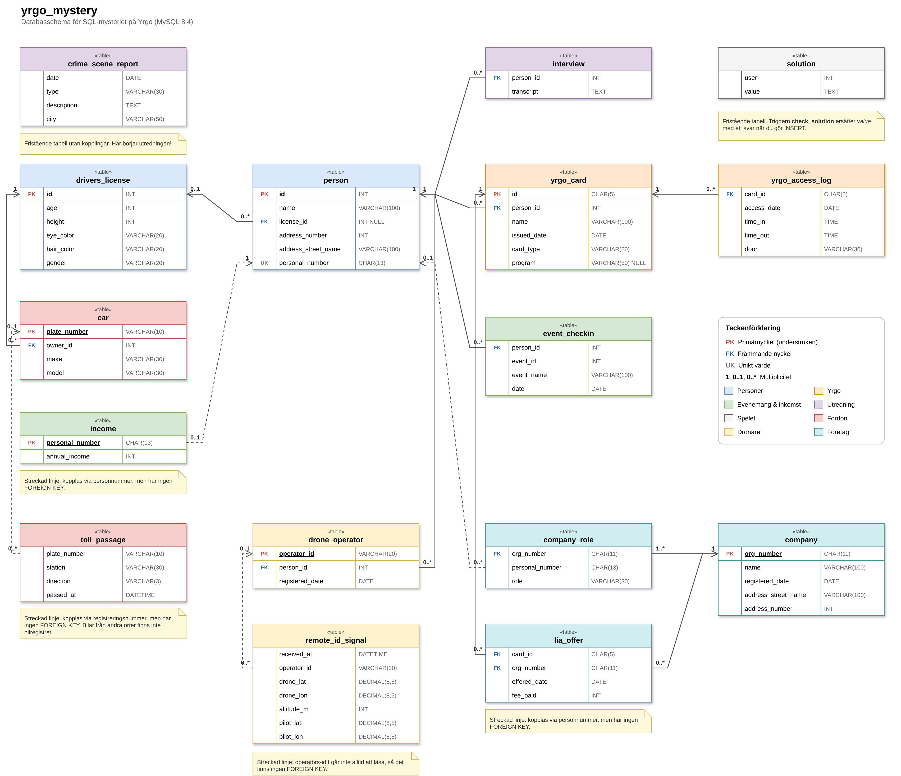

# SQL-mysteriet på Yrgo

Ett detektivspel där du löser ett brott med hjälp av SQL. Natten innan examensmässan på Yrgo i Göteborg försvinner en värdefull prototyp ur elektroniklabbet. Polisen behöver din hjälp att ta reda på vem som gjorde det. Ditt enda verktyg är en databas full av brottsrapporter, förhör, passerkort, körkort, bilar och mycket mer.

Spelet passar dig som lär dig SQL och vill öva på `SELECT`, `WHERE`, `JOIN`, `GROUP BY` och liknande på ett roligare sätt än vanliga övningsuppgifter.

Alla personer och händelser i spelet är påhittade.

## Det här behöver du

- **MySQL 8.4** (eller senare)
- Ett verktyg för att köra SQL-frågor, till exempel **MySQL Workbench**, **DataGrip**, **DBeaver** eller kommandoradsklienten `mysql`

## Kom igång

### 1. Ladda in databasen

Filen [yrgo_mystery.sql](yrgo_mystery.sql) skapar databasen `yrgo_mystery` med alla tabeller och all data.

> **Obs!** Om det redan finns en databas som heter `yrgo_mystery` raderas den och skapas på nytt. Det betyder också att du alltid kan köra skriptet igen för att börja om från början.

**Från kommandoraden:**

```bash
mysql -u root -p < yrgo_mystery.sql
```

**I MySQL Workbench:**

1. Anslut till din MySQL-server.
2. Välj *File → Open SQL Script…* och öppna `yrgo_mystery.sql`.
3. Kör hela skriptet med blixtknappen (*Execute*).
4. Uppdatera listan med scheman. Databasen `yrgo_mystery` ska nu synas.

**I DataGrip:**

1. Skapa en datakälla som ansluter till din MySQL-server.
2. Högerklicka på `yrgo_mystery.sql` och välj *Run 'yrgo_mystery.sql'…*. Välj sedan din datakälla som mål.
3. Uppdatera datakällan så att schemat `yrgo_mystery` dyker upp.

Andra verktyg fungerar på samma sätt: öppna filen och kör hela skriptet mot din server. Det tar en liten stund, eftersom databasen innehåller tiotusentals rader.

**Med Docker:**

Har du [Docker](https://www.docker.com/) behöver du inte installera MySQL alls. Bygg avbildningen och starta den:

```bash
docker build -t yrgo-mystery .
docker run -it --rm yrgo-mystery
```

Efter några sekunder hamnar du direkt i kommandoradsklienten `mysql` med databasen `yrgo_mystery` vald. Skriv `exit` för att avsluta.

Vill du hellre använda MySQL Workbench, DataGrip eller ett annat verktyg startar du servern i bakgrunden och öppnar port 3306:

```bash
docker run -d --name yrgo -p 3306:3306 yrgo-mystery
```

Anslut sedan till `127.0.0.1`, port `3306`, med användaren `root` och lösenordet `yrgo`. Kör du redan en egen MySQL-server på port 3306 väljer du en annan port, till exempel `-p 3307:3306`, och ansluter till port `3307`. Stoppa servern med `docker stop yrgo` och starta den igen med `docker start yrgo`. Du kan också lägga till `-p 3306:3306` i kommandot ovan för att få både kommandoradsklienten och porten samtidigt.

> **Obs!** Med `--rm` försvinner allt när du avslutar, även dina svar i `solution`. Vill du kunna fortsätta senare startar du i stället en namngiven behållare med `docker run -it --name yrgo yrgo-mystery` och återvänder till den med `docker start -ai yrgo`.

### 2. Börja utreda

Välj databasen och titta runt:

```sql
USE yrgo_mystery;

SHOW TABLES;
DESCRIBE crime_scene_report;
```

Sedan skriver du dina egna SQL-frågor i valfritt verktyg och följer ledtrådarna.

## Databasschema

Så här hänger tabellerna ihop (för extra guldstjärna använd inte denna bild utan
enbart SQL-klienten för att hitta information om tabellerna):



Diagrammet finns också som en redigerbar draw.io-fil: [schema.drawio](schema.drawio). Du kan öppna den på [app.diagrams.net](https://app.diagrams.net/), i draw.io-appen eller med draw.io-tillägget till VS Code.

## Uppdraget

> Ett brott har begåtts i Göteborg och polisen behöver din hjälp. Kommissarien gav dig brottsplatsrapporten, men du har lyckats tappa bort den. Du minns bara vagt att brottet var en **stöld** som skedde den **14 november 2025** i **Göteborg**.
>
> Allt du behöver finns i databasen. Börja med att hämta rätt brottsplatsrapport från tabellen `crime_scene_report` och följ sedan ledtrådarna.

## Kontrollera ditt svar

När du tror att du vet vem som är skyldig skriver du in personens fullständiga namn i tabellen `solution`:

```sql
INSERT INTO solution VALUES (1, 'Förnamn Efternamn');
SELECT value FROM solution;
```

Du får direkt veta om du har rätt. Om du har rätt kan det också hända att mysteriet inte är riktigt slut än…

Svaren lagras som hashar i databasen, så det går inte att fuska genom att läsa dem i skriptet.

Fallen hänger ihop, och de senare svaren godkänns bara när du har löst fallet före. Om du laddar om databasen behöver du alltså skriva in dina tidigare svar igen.

## Tips

- Använd `SHOW TABLES` och `DESCRIBE` för att förstå hur databasen ser ut.
- `SELECT DISTINCT kolumn FROM tabell` visar vilka värden en kolumn kan ha.
- `LIKE` med jokertecknet `%` är användbart när du bara vet en del av en text.
- Läs förhören noga. Varje detalj kan vara en ledtråd, men alla vittnen säger inte nödvändigtvis sanningen.
- Databasen använder svensk sortering, så å, ä och ö räknas som egna bokstäver. `'stöld'` är alltså inte samma sak som `'stold'`.

## Generera databasen själv

Datan i `yrgo_mystery.sql` skapas av Python-skriptet [generate.py](generate.py). Vill du ändra i berättelsen eller datan kan du redigera skriptet och generera en ny fil:

```bash
python generate.py yrgo_mystery.sql
```

Skriptet använder ett fast slumpfrö, så det ger exakt samma fil varje gång tills du ändrar något.

## Tack till

Spelet är kraftigt inspirerat av och bygger på idén bakom [**The SQL Murder Mystery**](https://github.com/NUKnightLab/sql-mysteries) av Joon Park och Cathy He på [Northwestern University Knight Lab](https://knightlab.northwestern.edu/). Ta en titt på originalet också!

## Licens

Projektet är licensierat under MIT-licensen. Se [LICENSE](LICENSE).
